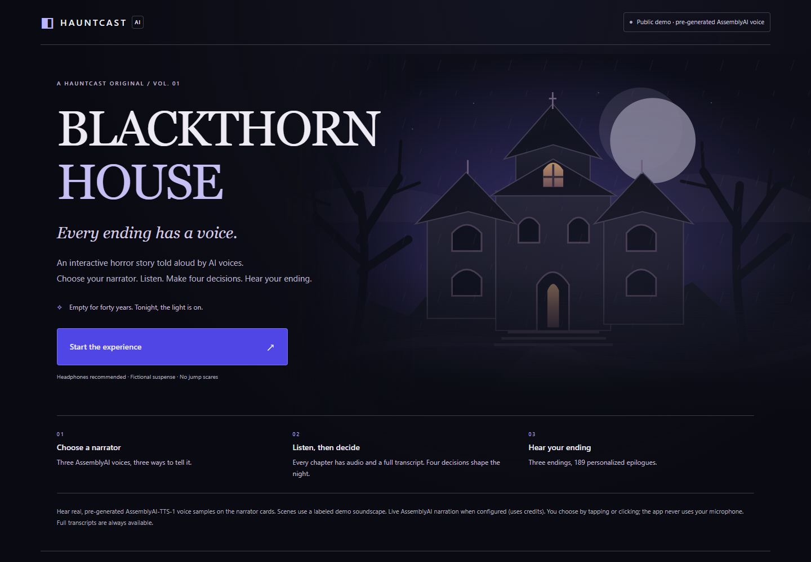
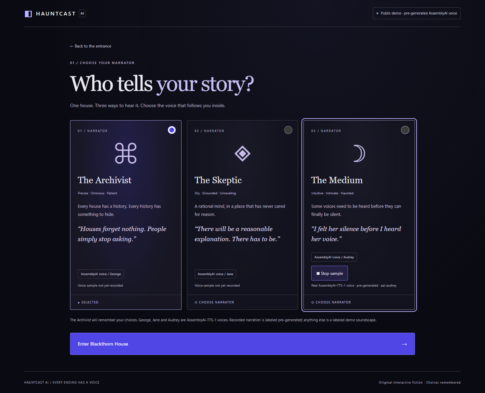

# BLACKTHORN HOUSE

**An interactive horror story told aloud by AssemblyAI voices. Choose your narrator, make four decisions, hear your ending.**



> **Live demo:** _not yet deployed — link will be added here_ · **Demo video:** _not yet recorded_

## What you can do

- **Pick who tells the story.** The Archivist (voice *George*), the Skeptic (*Jane*) and the Medium (*Audrey*) narrate the same haunted house from three very different perspectives. Narrator cards play real, pre-generated AssemblyAI voice samples (today: the Medium; George and Jane are pending one approved generation run).
- **Listen, then decide.** Four chapters, each with audio, original artwork and a full transcript. Every decision changes what comes next: the key stays in your coat, a promise can be kept or broken, an open window becomes your way out.
- **Hear your ending.** Liberation, Escape or Inheritance. The epilogue remembers your whole path: **189 personalized epilogues** (63 legal routes × 3 narrators), all written by hand.



## How AssemblyAI is used

BLACKTHORN HOUSE is built around **AssemblyAI-TTS-1** text-to-speech. Each narrator maps to one AssemblyAI voice (`aai-george`, `aai-jane`, `aai-audrey`), and the audio always speaks the exact text shown on screen.

| Mode | What happens | Where |
| --- | --- | --- |
| **Pre-generated (public demo)** | Narration was synthesized once, ahead of time, with the HTTP `/v1/speech` endpoint and is served as static files. Each file is keyed by a SHA-256 hash of narrator + exact scene text, so it can only play for the prose it speaks. Always labeled **ASSEMBLYAI · PRE-GENERATED**. | `backend/tools/pregenerate_narration.py`, `frontend/src/pregenerated.ts` |
| **Live streaming (restricted)** | The backend opens AssemblyAI's TTS WebSocket (`Begin → Generate → Flush → Audio → FlushDone → Terminate`) and streams PCM16 frames to the browser as NDJSON. Web Audio schedules each chunk as it arrives. Pause, mute, cancel and cache-only replay are all supported. | `backend/app/assemblyai.py`, `frontend/src/pcm.ts`, `frontend/src/useAudio.ts` |
| **Fallback** | Scenes without a recording use a locally generated soundscape (and, optionally, your device's speech voice). Always labeled **MOCK AUDIO**; never presented as AssemblyAI speech. | `backend/app/voice.py` |

**Credit safety.** The API key stays on the server and never reaches the browser. The public deployment refuses to start with live TTS enabled. Live streaming requires a JWT, a separate private proxy token, and an existing SQLite ledger that reserves every attempt and character *before* any network call. There are no automatic paid retries, and replay never pays twice.

## What makes it different

- **Listening first.** The player is the centerpiece of every scene; the transcript is one tap away.
- **The voice is the character.** Three narrators who read the same evidence in three ways, each with an AssemblyAI voice.
- **Consequences that are remembered.** A deterministic story engine with server-owned memory. No LLM, so every route is tested and the narration always matches what you see.
- **Honest audio.** Every playback says what it is: live, pre-generated AssemblyAI, or demo soundscape.

The app never listens to you. There is no microphone or speech recognition; you choose by tapping or clicking.

## Run it locally

Requires Python 3.11+ (validated on 3.14) and Node.js 20.19+ (validated on 24). No API key is needed.

```powershell
# Windows PowerShell, from the repository root
py -m venv .venv
.\.venv\Scripts\python.exe -m pip install -r backend/requirements.lock.txt
$env:VOICE_PROVIDER = 'mock'
.\.venv\Scripts\python.exe -m uvicorn app.main:app --app-dir backend --host 127.0.0.1 --port 8000 --workers 1
```

In a second terminal:

```powershell
cd frontend
npm.cmd ci
npm.cmd run dev    # open http://127.0.0.1:5173
```

On macOS/Linux use `python3 -m venv .venv`, `.venv/bin/python …` and `npm`. Set `VOICE_PROVIDER=mock` explicitly if your private `.env` selects live TTS; otherwise live playback is (correctly) refused without the restricted proxy token and ledger.

Run everything as production does, in one process:

```powershell
cd frontend; npm.cmd run build; cd ..
$env:DEPLOYMENT_MODE='public'; $env:FRONTEND_DIST="$PWD\frontend\dist"
$env:JWT_SECRET = .\.venv\Scripts\python.exe -c "import secrets; print(secrets.token_urlsafe(48))"
.\.venv\Scripts\python.exe -m uvicorn app.main:app --app-dir backend --port 8000 --workers 1
```

## Status (2026-11-05)

- **Working:** full story on desktop and mobile, with three narrators and three endings. Every scene and all 189 personalized epilogues are narrated with real, pre-generated AssemblyAI-TTS-1 audio: 246 recordings, one per unique (narrator, text) pair, in George, Jane and Audrey's voices. The labeled mock fallback plays only if a recording can't be matched. Live at https://blackthorn-house.onrender.com in a hardened single-container build. See [VALIDATION.md](VALIDATION.md) for exact test results.
- **Verified earlier with real credits (2026-10-29):** one HTTP synthesis (Audrey, 51 characters, 3.52 s WAV, the sample shipped here) and one WebSocket stream (27 PCM chunks played incrementally in the browser).
- **Narration run (2026-11-05):** 246 HTTP requests and 139,550 characters, billed exactly as planned with no errors or retries. Every file is checked offline against its voice and text hash and decoded in Edge.
- **Limits:** stories live in memory on one worker and expire after an hour; a restart or reload starts over. One scenario, four decisions.

## More

[DEPLOYMENT.md](DEPLOYMENT.md) (free hosting, security model, restricted live mode) · [VALIDATION.md](VALIDATION.md) (test evidence) · [SUBMISSION.md](SUBMISSION.md) (hackathon description, demo script) · [docs/](docs/) (engineering history)

React 19 · TypeScript · Vite · Zod · Web Audio · Python · FastAPI · Pydantic · PyJWT · httpx · websockets · SQLite
